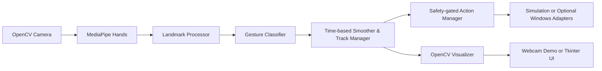

# Syntecxhub Hand Gesture Recognition System

**Internship:** Syntecxhub Artificial Intelligence Internship  
**Task:** Week 3 – Project 2  
**Developer:** Surag M S  
**Repository:** `Syntecxhub_Hand_Gesture_Recognition`

A local Windows desktop application that uses a real webcam, OpenCV, and MediaPipe hand landmarks to recognize simple hand gestures in real time. It provides the required standalone webcam demonstration and an optional responsive Tkinter interface.

> **Safety first:** Gesture-triggered operating-system actions are **disabled by default**. The default action adapters simulate and display an intended action without changing media playback or system volume. Real actions require explicit user enablement and optional Windows dependencies.

## Official requirements covered

- Live MediaPipe hand-landmark detection (up to two hands).
- Real geometric recognition of **Thumbs Up**, **Fist**, and **Open Palm**.
- Configurable gesture-to-action mapping.
- A working independent webcam demonstration: [`scripts/webcam_demo.py`](scripts/webcam_demo.py).

## Features

### Mandatory implementation

- Fresh live webcam frames through OpenCV, including Windows DirectShow/Media Foundation fallback.
- MediaPipe Hands landmark extraction: 21 normalized points per detected hand.
- Handedness labels and up-to-two-hand visualization.
- Geometric, scale-normalized classification: `THUMBS_UP`, `FIST`, `OPEN_PALM`, and conservative `UNKNOWN` fallback.
- Time-based smoothing and time-based hand-loss reset instead of frame-count-only behavior.
- Capture-to-annotated-frame engine-pipeline FPS and visual status feedback.
- Independent action cooldowns, rearming, and one-primary-hand policy to prevent duplicate accidental actions.
- Default-disabled/simulation-first media and volume mappings.
- Camera, detector, and OpenCV resource cleanup.
- Unit tests that mock camera/action behavior and do not alter real media or volume.

### Optional features

- Tkinter desktop UI with camera controls and a worker-thread processing pipeline.
- Optional PyAutoGUI media-key backend.
- Optional pycaw Windows Core Audio volume backend.
- Additional classifier vocabulary (`PEACE`, `POINTING`, `THUMBS_DOWN`, `PINCH`) is present for future configuration but is not assigned a default system action.

## Gesture mappings

| Stable gesture | Default mapping | Safety behavior |
| --- | --- | --- |
| `THUMBS_UP` | Play/Pause | Dispatches once, then requires rearming. |
| `OPEN_PALM` | Volume Up | Dispatches once, then requires rearming. |
| `FIST` | Neutral/rearm | Visible but intentionally has no system command. |
| `UNKNOWN` | None | Never triggers an action. |

Heuristic evidence values shown by the classifier are **not calibrated machine-learning probabilities**.

## Architecture



- **Core recognition** has no MediaPipe, OpenCV, Tkinter, or OS-action dependency where pure logic is possible.
- **Actions** are isolated behind adapters; their default controllers are in-memory simulations.
- **Presentation** receives already-processed results, never directly touches the classifier or operating-system actions.

## Project structure

```text
.
├── main.py                     # GUI launcher
├── app.py                      # Optional Tkinter app entry point
├── config.py                   # Validated runtime defaults
├── core/
│   ├── camera.py               # Capture lifecycle and Windows fallback
│   ├── hand_detector.py        # MediaPipe adapter
│   ├── landmark_processor.py   # Pure normalization/geometry input
│   ├── gesture_classifier.py   # Mandatory gesture classification
│   ├── gesture_smoother.py     # Time-based stabilization
│   ├── gesture_controller.py   # Two-hand association/recognition pipeline
│   ├── action_manager.py       # Cooldown/rearm safety policy
│   ├── engine.py               # Reusable live processing coordinator
│   ├── performance_monitor.py  # Actual measured FPS
│   └── visualizer.py           # Landmarks and status overlays
├── actions/                    # Simulation and optional system adapters
├── ui/                         # Thread-safe Tkinter components
├── scripts/
│   ├── webcam_demo.py          # Required independent live demo
│   ├── test_camera.py          # One-frame diagnostic
│   └── test_gestures.py        # Synthetic fixture diagnostic
├── tests/                      # Hardware-safe pytest suite
├── docs/                       # Architecture, installation, guide, testing
├── models/README.md            # MediaPipe model usage note
├── assets/                     # Project assets placeholder
└── screenshots/                # Genuine captures only
```

## Prerequisites

- **Windows 10 or Windows 11**, 64-bit.
- **Python 3.11, 64-bit** (the documented/recommended baseline).
- Integrated or USB webcam.
- No NVIDIA GPU, CUDA, TensorFlow, or PyTorch is required.

MediaPipe and OpenCV use native wheels whose availability can vary with Python versions. Use the Python 3.11 baseline before reporting an installation issue.

## Installation

```bash
python --version
```

```bash
python -m venv .venv
```

**PowerShell:**

```bash
.\.venv\Scripts\Activate.ps1
```

If PowerShell prevents activation, scope the policy change to **only the current PowerShell process** and then activate again:

```bash
Set-ExecutionPolicy -Scope Process -ExecutionPolicy Bypass
```

```bash
.\.venv\Scripts\Activate.ps1
```

```bash
python -m pip install --upgrade pip
```

```bash
python -m pip install -r requirements.txt
```

Do not install multiple OpenCV distributions (`opencv-python`, `opencv-contrib-python`, or `*-headless`) into the same environment. The project declares one GUI-capable OpenCV distribution for the supported baseline.

### Optional real Windows actions

Install these only if you deliberately want live host integration after validating simulation mode:

```bash
python -m pip install pyautogui==0.9.54 pycaw==20240210 comtypes==1.4.7
```

## How to run

### Camera diagnostic

```bash
python scripts\test_camera.py
```

### Mandatory independent webcam demo

```bash
python scripts\webcam_demo.py
```

Choose a different camera or resolution if needed:

```bash
python scripts\webcam_demo.py --camera 1 --width 1280 --height 720
```

Inspect all options:

```bash
python scripts\webcam_demo.py --help
```

Start with **simulation/disabled action mode**. Only after validating recognition should you make an explicit choice to allow dispatch:

```bash
python scripts\webcam_demo.py --enable-actions --action-backend windows
```

`windows` may still return a visible, non-fatal backend error until the optional dependencies are installed and a compatible media/audio endpoint is available.

### Optional desktop GUI

```bash
python main.py
```

or:

```bash
python app.py --camera 0
```

The GUI keeps camera/MediaPipe work in a worker thread and updates Tk widgets on the Tk event loop only.

## Webcam demo keyboard shortcuts

| Key | Behavior |
| --- | --- |
| `Q` or `Esc` | Quit and release camera/MediaPipe/OpenCV resources. |
| `A` | Toggle action dispatch and update its visible state. |
| `R` | Clear tracks, smoothing history, cooldowns, and rearming state. |
| `S` | Save the current annotated image in [`screenshots/`](screenshots/). |

## Gesture-control guidance

1. Place one open hand plainly in the center of the preview under even lighting.
2. Keep the hand mostly facing the camera. Extreme rotations, occlusion, and motion blur intentionally tend toward `UNKNOWN`.
3. Hold the desired gesture long enough for the on-screen smoother to stabilize it.
4. `THUMBS_UP` requires an upward thumb in camera coordinates and folded other fingers.
5. A held actionable gesture causes one action, not repeated actions. Return to `FIST`, change gesture, or remove the hand long enough to rearm before triggering it again.
6. Two hands can be displayed, but only one primary tracked hand may trigger an action.

## Testing

```bash
python -m pytest -q
```

Tests are designed not to access a real camera or send a media key/volume command. See [testing guidance](docs/TESTING.md) and the [hardware validation record](docs/HARDWARE_VALIDATION.md) for coverage and manual verification procedure.

### Most recent automated evidence

| Check | Status | Actual result | Scope |
| --- | --- | --- | --- |
| `python -m compileall .` | **PASSED** | Completed with Python 3.14.4 | Syntax/bytecode compilation only. |
| `python -m pytest -q` | **PASSED** | `27 passed` | Pure/mocked logic; no real camera or OS controls. |
| CLI help and synthetic fixture diagnostic | **PASSED** | All three entry-point help commands returned; fixture reported `OPEN_PALM`. | Argument wiring and synthetic classifier path only. |
| Live webcam / MediaPipe / GUI preview | **BLOCKED** | Active MediaPipe 0.10.35 has no `mp.solutions` legacy API under Python 3.14.4. | Requires documented Python 3.11 environment and manual evidence. |
| Real Play/Pause and system-volume control | **NOT TESTED** | Deliberately not enabled. | Requires explicit operator opt-in after simulation validation. |

## Hardware verification status

This checkout's active Python 3.14.4 installation has MediaPipe 0.10.35 without the legacy `mp.solutions` Hands surface. The supported live-validation baseline remains a dedicated 64-bit Python 3.11 virtual environment with the pinned requirements. Camera, landmark accuracy, action behavior, real FPS, and resource release after a real session remain manual validation items; this README does **not** claim they passed.

## Troubleshooting

| Symptom | Suggested resolution |
| --- | --- |
| “Unable to access webcam” | Close other camera apps, check Windows privacy permissions, try `--camera 1`, then run `scripts/test_camera.py`. |
| `ModuleNotFoundError` | Activate `.venv` and reinstall `requirements.txt` using the documented Python 3.11 baseline. |
| No hand landmarks | Improve lighting, show a full hand, reduce blur, and make sure the hand is inside frame. |
| Gesture becomes `UNKNOWN` | This is a safety behavior for ambiguous/folded/rotated positions. Reposition the hand rather than lowering safety thresholds blindly. |
| Action backend unavailable | Continue using recognition/simulation; install only the optional dependency required by the selected backend. |
| Media key does nothing | Global media-key behavior depends on the active player and Windows audio/media integration. Recognition remains functional. |

## Performance, limitations, and future improvements

The default 640×480 configuration, one reused MediaPipe detector, and light geometric calculations target ordinary CPU-only laptops with at least 4 GB RAM. The on-screen FPS is a rolling **capture-to-annotated-frame engine-pipeline** measurement: it includes camera read, mirror, MediaPipe inference, recognition, action decision, and overlay drawing. It excludes `cv2.imshow`, `cv2.waitKey`, Tk image conversion/event handling, and monitor refresh. Actual performance depends on camera drivers, CPU, resolution, lighting, and the installed MediaPipe wheel—no numerical benchmark has been collected in the current environment.

Known limitations:

- Geometric recognition is intentionally conservative and does not replace a trained sign-language model.
- Extreme roll/rotation, foreshortening/depth variation, partial hands, self-occlusion, poor lighting, motion blur, and unusual camera angles can produce `UNKNOWN` or a false classification.
- `THUMBS_UP` is defined relative to image-up, so strongly rotated hands are intentionally unreliable.
- Handedness is detector-supplied metadata; a mirrored preview changes visual intuition but not geometric classification.
- Two hands are rendered, but wrist-distance tracking can swap identities when hands cross, move rapidly, or are occluded. Only one primary track is action-eligible.
- Camera/driver access remains environment-specific. Media controls are global OS requests, and not every player/audio endpoint responds.
- The project supports Windows action backends, while the pure recognition core is largely cross-platform.

Future work can add calibrated real-landmark fixtures, an official MediaPipe Tasks migration, robust multi-hand association, and accessibility customization.

## GitHub submission

1. Create or initialize the repository as **`Syntecxhub_Hand_Gesture_Recognition`**.
2. Add an accurate description: *“Real-time AI Hand Gesture Recognition System using Python, OpenCV, and MediaPipe, featuring webcam hand tracking, gesture classification, media control, and volume control.”*
3. Commit source, tests, documentation, and only genuine screenshots; never commit `.venv`, logs, `.env`, recordings, or secrets.
4. Run the documented tests and record any hardware verification separately.
5. Push the branch to GitHub and add real execution screenshots only after capturing them from this application.

## License

Distributed under the [MIT License](LICENSE).
