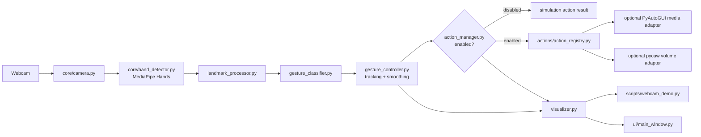

# Architecture

## Design priorities

1. **Local processing:** webcam frames remain local. The project does not upload frames or bundle network telemetry.
2. **Separation of concerns:** camera capture, MediaPipe conversion, geometry, temporal recognition, actions, and presentation have distinct modules.
3. **Fail closed for side effects:** actions are disabled by default; simulation adapters are the default even once action code exists.
4. **Graceful degradation:** invalid frames, missing optional modules, and action-backend failures show status while recognition remains available where possible.
5. **Testability:** the classifier, smoother, track association, and action policy use project-native models rather than SDK/UI types.

## Component view

## Runtime flow

1. `Camera` opens a configured OpenCV camera. On Windows it tries DirectShow, then Media Foundation, then OpenCV's default backend when `backend="auto"`.
2. Every `read()` produces one fresh BGR frame or an actionable `CameraError`; stale frames are not intentionally reused.
3. `HandDetector` converts the current BGR frame to RGB for MediaPipe once and adapts each 21-point result to a dependency-free `HandObservation`.
4. `LandmarkProcessor` checks shape/finite coordinates, derives robust palm scale, and creates normalized points.
5. `GestureClassifier` calculates joint-angle, extension, compactness, and orientation evidence. It conservatively returns a mandatory gesture or `UNKNOWN`.
6. `GestureController` assigns short-lived wrist/handedness tracks, updates time-based smoothing, and expires stale tracks.
7. `ActionManager` selects a stable primary hand, enforces disabled mode, neutral rearming, and cooldown before delegating to a registry.
8. `Visualizer` annotates the same fresh frame with landmarks, connections, bounding boxes, status, and measured FPS.
9. The standalone demo displays the image with OpenCV; the GUI transfers latest results through a bounded queue and updates Tk only from its event loop.

## Module boundaries

| Area | Primary files | Responsibility |
| --- | --- | --- |
| Configuration | [`config.py`](../config.py) | Validated defaults and action/camera policy. |
| Camera | [`core/camera.py`](../core/camera.py) | OpenCV device lifecycle and backend fallback. |
| Detector | [`core/hand_detector.py`](../core/hand_detector.py) | MediaPipe SDK adapter only. |
| Recognition | [`core/models.py`](../core/models.py), [`core/landmark_processor.py`](../core/landmark_processor.py), [`core/gesture_classifier.py`](../core/gesture_classifier.py) | Typed data, scale-normalization, pure geometry. |
| Stabilization | [`core/gesture_smoother.py`](../core/gesture_smoother.py), [`core/gesture_controller.py`](../core/gesture_controller.py) | Elapsed-time voting, tracking, and multi-hand coordination. |
| Safe actions | [`core/action_manager.py`](../core/action_manager.py), [`actions/`](../actions/) | Mapping, cooldown/rearm, simulation/live adapter boundary. |
| Presentation | [`core/visualizer.py`](../core/visualizer.py), [`ui/`](../ui/) | Fresh-frame overlays and Tk-safe display. |
| Composition | [`core/engine.py`](../core/engine.py), [`scripts/webcam_demo.py`](../scripts/webcam_demo.py), [`app.py`](../app.py) | Runtime ownership and entry points. |

## Recognition and safety decisions

### Mandatory gesture rules

- **Open Palm:** all non-thumb fingers must meet extension signals; the thumb must be extended; otherwise the classifier prefers `UNKNOWN`.
- **Fist:** all non-thumb fingers must be folded with a non-extended thumb and compact tips.
- **Thumbs Up:** thumb is extended and directed upward in image coordinates while other fingers are folded.
- **Unknown:** a valid detected hand that is ambiguous, partial, highly rotated, or below a threshold. It has no action mapping.

The classifier returns heuristic evidence, not a calibrated probability. No trained gesture model is claimed.

### Temporal stability

`GestureSmoother` uses timestamps, a trailing window, exponential time decay, evidence weights, and a consensus threshold. It does not assume a fixed camera FPS. `GestureController` keeps tracking and action decisions separate: a raw gesture may appear in the UI before it becomes stable.

### Multiple hands

The detector returns up to two hands. Both receive independent classification and overlay. The action pipeline uses a deterministic single primary track per frame, avoiding duplicate/conflicting actions from simultaneous hands.

### Action boundary

`ActionRegistry` uses `SimulationMediaController` and `SimulationVolumeController` by default. They make no external change. Optional lazy-import backends return structured failures when unavailable rather than crashing recognition. The manager dispatches only after explicit enablement, cooldown, and a neutral `FIST` rearm state.

## Failure handling and cleanup

- Camera unavailable/empty frame: clear `CameraError` and release capture in cleanup.
- MediaPipe unavailable/incompatible: a descriptive detector error explains the supported environment.
- Optional action APIs unavailable: a visible `ActionResult` failure; detector/preview remain independent.
- Demo loop: `finally` closes detector/camera and calls `cv2.destroyAllWindows()`.
- GUI: the worker owns camera/detector resources; the Tk thread uses `after()` and never directly receives worker-side widget calls.
